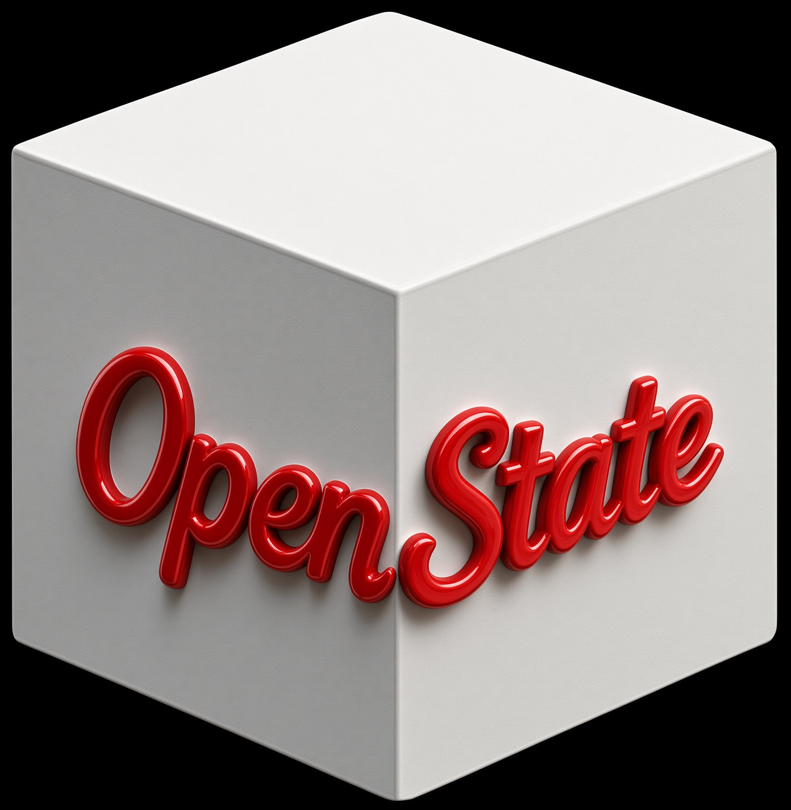

<div align="center">
  
</div>

# openstate

> **OpenState keeps a running record of what is true in a project (decisions, finished and failed work, what is blocked), updates it as later events replace it, and gives it to the coding agent at the start of every session and after every compaction.**

[](PUBLIC-LICENSE)
[](https://rustup.rs/)
[](https://opencode.ai)

[](https://github.com/sponsors/Michael-A-Kuykendall)

**openstate is commercial software.** You buy a license through Stripe on the [pricing page](https://michael-a-kuykendall.github.io/openstate/pricing.html); Keygen issues the key. The engine runs locally, needs no account, and sends nothing anywhere.

### 💝 Support openstate's Growth

🚀 **If openstate helps you, [sponsoring](https://github.com/sponsors/Michael-A-Kuykendall) supports its development.** Sponsorship is separate from buying a license.

- **$5/month**: Coffee tier ☕ - Eternal gratitude + sponsor badge
- **$25/month**: Bug prioritizer 🐛 - Priority support + name in [SPONSORS.md](SPONSORS.md)
- **$100/month**: Corporate backer 🏢 - Logo placement + monthly office hours
- **$500/month**: Infrastructure partner 🚀 - Direct support + roadmap input

[**🎯 Become a Sponsor**](https://github.com/sponsors/Michael-A-Kuykendall)

---

## Table of Contents

- [What Is openstate?](#what-is-openstate)
  - [Three problems it addresses](#three-problems-it-addresses)
  - [Who it is for](#who-it-is-for)
- [🔧 Architecture](#architecture)
- [📦 Install](#install)
- [Other hosts: the MCP server](#other-hosts-the-mcp-server)
- [🚀 Quick Start](#quick-start)
- [🛠 AI Tools](#ai-tools)
- [📖 Documentation Hub](#documentation-hub)
- [🏛️ License & Philosophy](#license--philosophy)
- [🌍 Community & Support](#community--support)

---

## What Is openstate?

OpenState keeps a running record of what is true in a project (decisions, finished and failed work, what is blocked), updates it as later events replace it, and gives it to the coding agent at the start of every session and after every compaction.

It is an **OpenCode extension**: a local engine plus a plugin, with its state kept in your repository. Other MCP hosts (Claude Code, Muse, Kiro, GitHub Copilot) use the same engine through the bundled MCP server.

### Three problems it addresses

| Problem | What OpenState records | Where the agent sees it |
|---|---|---|
| The agent re-runs a command that already failed in an earlier session. | Each failed command. | `failed_attempts` in the capsule; `openstate_report`; `openstate_report_timeline` shows which session it failed in. |
| After a compaction or a restart, the agent re-reads files to work out what it was doing. | The objective, recent decisions, the files being worked on, uncommitted changes, and whether a test has passed since the last edit. | The capsule, added to the context at the start of the session and after each compaction. |
| The agent retries an approach that was already rejected. | Decisions: messages that give a reason ("because ..."), recorded with that reason. | `decisions` in the capsule; `openstate_why` shows where a decision came from. |

### Who it is for

Developers running long coding-agent sessions in OpenCode who want each new session, and each session after a compaction, to start from what was decided, done, failed and blocked. Claude Code, Muse, Kiro and GitHub Copilot work too, through the bundled MCP server.

### Who it is not for

- **A knowledge base or documentation search.** It records what happens in sessions, not your documents.
- **Semantic or vector search over code.** Use the structural tools or your editor.
- **A hosted or team service.** Everything stays on one machine, in one repository.
- **A transcript store.** It keeps the current state, not the conversation.


**🔧 The engine is proprietary** (distributed under a commercial EULA). The surface components — documentation, skill, installer, plugin bundle — are MIT-licensed. Commercial licensing for embedding the engine in other products is available.

---

## Architecture

### 1. OpenCode Observer Plugin (TypeScript)

Captures events: `message.updated`, `tool.execute.before/after`, `file.edited`, `todo.updated`, `session.idle`, `session.compacted`, etc.

### 2. Local Rust State Engine

Turns those events into project facts (objectives, decisions, completed and failed commands, blockers) and replaces or closes a fact when a later event supersedes it. `openstate_why` shows where any fact came from.

### 3. Resume Capsule

A structured continuation contract injected automatically on new sessions and compaction — a few hundred tokens (median about 500, at most about 1,600 across 21 real project stores), carrying the state needed to resume work.

---

## Install

```bash
# 1. One-liner (curl|bash — downloads prebuilt bundle, installs into CWD)
curl -fsSL https://raw.githubusercontent.com/Michael-A-Kuykendall/openstate/main/install.sh | bash

# 2. Target a specific repo
curl -fsSL https://raw.githubusercontent.com/Michael-A-Kuykendall/openstate/main/install.sh | OPENSTATE_CONFIG_DIR=/path/to/repo/.opencode bash

# 3. Clone once, install anywhere
git clone --depth 1 https://github.com/Michael-A-Kuykendall/openstate.git /tmp/os
/tmp/os/install.sh
OPENSTATE_CONFIG_DIR=/path/to/other/.opencode /tmp/os/install.sh
```

Downloads the prebuilt engine binary + plugin bundle from GitHub Releases, verifies sha256, smoke-tests the engine, and installs the complete bundle into **this repo's** `.opencode/` directory. No compiler is needed; the installer does need Node.js to update the JSON config files. By default openstate is **per-repo**: it only activates in repos that run `install.sh` (`--global` installs it once for every repository). Restart OpenCode, done.

Verify an existing install: `./install.sh --check`

Remove it with `./install.sh --uninstall` (keeps `.openstate/` state) or `./install.sh --purge` (deletes it too). What survives a crash: [docs/TRUST.md](docs/TRUST.md).

State lives per-project in `.openstate/state.jsonl`. Read it through the tools (`openstate_state`, `openstate_export`), not the file: its format is internal and may change.

---

## Other hosts: the MCP server

The same bundle carries an MCP server, `mcp/openstate-mcp.mjs`, for every host that is not OpenCode. Run `install.sh` in the repository as above (it puts the server at `.opencode/mcp/openstate-mcp.mjs`, beside the engine), then register it with your host. It needs Node.js 18 or newer.

| Host | File in the repository | Entry |
|---|---|---|
| Claude Code, Muse | `.mcp.json` | `{"mcpServers": {"openstate": {"command": "node", "args": ["/path/to/repo/.opencode/mcp/openstate-mcp.mjs"]}}}` |
| Kiro | `.kiro/settings/mcp.json` | `{"mcpServers": {"openstate": {"command": "node", "args": ["/path/to/repo/.opencode/mcp/openstate-mcp.mjs"]}}}` |
| GitHub Copilot in VS Code | `.vscode/mcp.json` | `{"servers": {"openstate": {"type": "stdio", "command": "node", "args": ["${workspaceFolder}/.opencode/mcp/openstate-mcp.mjs"]}}}` |

Use the absolute path to the installed file (after `--global`, `~/.config/opencode/mcp/openstate-mcp.mjs`). The server offers 34 tools: the 14 state tools except `openstate_restart` and `openstate_toast` (both OpenCode-only), and all 22 structural tools. Each tool takes the repository directory as `repo_dir`. These hosts give OpenState no way to put the capsule into the context by itself, so the server's instructions tell the agent to call `openstate_capsule` at the start of a session and after a compaction.

---

## Quick Start

```bash
# In any repo
curl -fsSL https://raw.githubusercontent.com/Michael-A-Kuykendall/openstate/main/install.sh | bash

# Restart OpenCode
 # You now have 36 AI tools (14 state + 22 structural) + TUI sidebar (status line + completion toasts) + skill
 ```

---

## Human-visible feedback

Two surfaces report openstate activity (both driven by OpenCode's `message.part.updated` ToolPart events — the one signal path that actually fires for custom-tool lifecycle):

- **Always-on sidebar status** (`● openstate / battery ready`) — live status. While an `openstate_*` command runs, "battery ready" swaps to `<command>: …` and the green dot animates, then settles back. Always on.
- **Completion toasts** — a transient TUI notification confirming what finished (e.g. `✓ doctor · engine OK · 7796 facts`), coalesced into one toast for back-to-back bursts. On by default.

**Turning toasts off:** an AI-driven toggle — ask the agent "turn off the openstate toasts", which calls `openstate_toast` with `enabled: false`. Persisted per-project in `.openstate/toasts.json`. The sidebar status line keeps working regardless.

> Note on tool output in the transcript: a tool's returned text feeds the model and appears in the chat only when the user enables "Show generic tool output" in the TUI (an opt-in OpenCode setting). The sidebar + toasts above are the guaranteed human-visible surfaces.

---

## AI Tools

The AI gets 36 tools automatically via the OpenCode plugin: 14 state tools and 22 structural tools. The state tools:

| Tool | Purpose |
|------|---------|
| `openstate_state` | Full project state: objective, decisions, in-progress, blockers, next actions |
| `openstate_why` | Provenance chain for any fact |
| `openstate_checkpoint` | Force-flush state to disk |
| `openstate_capsule` | Resume contract (frontier views + validation + change frontier) |
| `openstate_export` | Full state dump as JSON |
| `openstate_reset` | Deliberate full wipe (start over / privacy scrub) |
| `openstate_assess` | Absorb current or prior session into the battery |
| `openstate_report` | Black-box "what's broken/stuck" readout |
| `openstate_report_timeline` | Chronological session→facts map |
| `openstate_close` | Retract false positives / resolved items |
| `openstate_sessions` | List prior sessions for assessment |
| `openstate_doctor` | Engine health check |
| `openstate_restart` | Restart engine sidecar |
| `openstate_toast` | Toggle the completion toasts ON/OFF (per-project; default ON) |

Plus 22 structural tools (AST and text search, bounded reads, references, declarations, and preview/apply edits, renames, inserts, moves, deletes and new files; symbol tools in 18 languages). The `.opencode/skills/openstate/SKILL.md` skill tells the AI when to use them.

---

## Documentation Hub

| Document | Purpose |
|----------|---------|
| [README.md](README.md) | This file |
| [ROADMAP.md](ROADMAP.md) | Vision, milestones, non-goals |
| [CHANGELOG.md](CHANGELOG.md) | Keep-a-Changelog history |
| [CONTRIBUTING.md](CONTRIBUTING.md) | Maintainer-only PR model + DCO |
| [DCO.md](DCO.md) | Developer Certificate of Origin |
| [GOVERNANCE.md](GOVERNANCE.md) | Lead maintainer authority |
| [SECURITY.md](SECURITY.md) | Vulnerability disclosure |
| [CODE_OF_CONDUCT.md](CODE_OF_CONDUCT.md) | Community standards |
| [LICENSE](LICENSE) | Proprietary engine + MIT surface |
| [PUBLIC-LICENSE](PUBLIC-LICENSE) | MIT for surface components |
| [NOTICE](NOTICE) | Attribution & commercial licensing |
| [SPONSORS.md](SPONSORS.md) | Sponsor tiers & recognition |
| [SKILL.md](SKILL.md) | AI usage skill |
| [docs/FAQ.md](docs/FAQ.md) | Frequently asked questions |
| [docs/TRUST.md](docs/TRUST.md) | What survives a crash, failure modes, uninstall and purge |

---

## License & Philosophy

**Engine binary (openstate-engine):** Proprietary, distributed under a commercial EULA.  
**Surface components (docs, skill, installer, plugin bundle):** MIT License — see [PUBLIC-LICENSE](PUBLIC-LICENSE).  
**Commercial licensing** for embedding the engine in other products: contact `michaelallenkuykendall@gmail.com`.

### Philosophy

- **Per-repo by default** — `install.sh` targets the repository's `.opencode/`; `--global` is opt-in.
- **Deliberate persistence** — state is written on `openstate_checkpoint`, when OpenCode closes, and when the engine's input ends. What a checkpoint wrote survives the engine being killed.
- **Provenance** — `openstate_why` shows where any fact came from.

---

## Community & Support

- **GitHub Issues** — questions, bugs, feature requests
- **Security** — see [SECURITY.md](SECURITY.md) for private disclosure
- **Sponsors** — [GitHub Sponsors](https://github.com/sponsors/Michael-A-Kuykendall) / [SPONSORS.md](SPONSORS.md)

### Code of Conduct

This project follows the [Contributor Covenant](CODE_OF_CONDUCT.md). By participating, you agree to uphold its standards.

### Contributing

See [CONTRIBUTING.md](CONTRIBUTING.md) — **maintainer-only PRs**, DCO sign-off required. Non-maintainers contribute via issues.

### Governance

See [GOVERNANCE.md](GOVERNANCE.md) — lead maintainer authority, roadmap ownership.

### Security

See [SECURITY.md](SECURITY.md) — private disclosure via GitHub Security Advisories or `michaelallenkuykendall@gmail.com`.

---

## License

Engine binary: Proprietary EULA (see [LICENSE](LICENSE))  
Surface components: MIT (see [PUBLIC-LICENSE](PUBLIC-LICENSE))  
Commercial licensing: `michaelallenkuykendall@gmail.com`