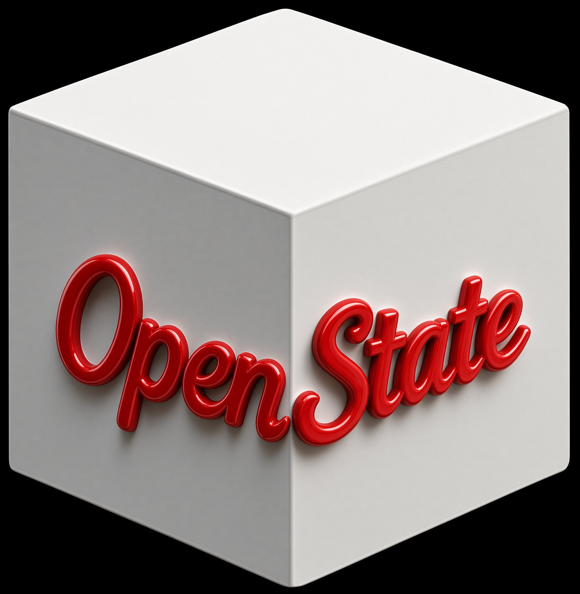

<div align="center">
  
</div>

# openstate

> **A continuously maintained, retractable project-state model for coding agents.**

[](PUBLIC-LICENSE)
[](SECURITY.md)
[](https://rustup.rs/)
[](https://opencode.ai)

[](https://github.com/sponsors/Michael-A-Kuykendall)

**openstate will be free forever.** No asterisks. No "free for now." No pivot to paid.

---

## The Problem

Standard AI coding session:
```
600k tokens → compact / end → summarize → hope the important parts survived
```

Symptoms everyone knows:
- Re-running commands that already failed
- Re-reading the same files
- Re-trying rejected approaches
- Losing mid-edit state on crash
- New session starts with a smoothie of guesswork

---

## The Solution

Events (messages, tool calls, file edits, todos, git, …) flow continuously into a local engine.  
The engine maintains **current project truth** — not a transcript.

Next session receives a **1,000–5,000-token resume capsule** (structured continuation contract) instead of a lossy summary.

### Key Properties
- Continuously derived facts with automatic retraction
- Full provenance (`openstate_why`)
- Deliberate, crash-safe persistence
- Per-repo, zero-config, local-only

---

## The Numbers

| Metric | Value |
|--------|-------|
| **Facts tracked** | **60,732** |
| **Self-corrections** | **30,007** |
| **Commands tracked** | 16,457 |
| **Work completed** | 10,346 |
| **Crashes recovered** | **14** → **0 work lost** |
| **Capsules generated** | 30 |
| **Assessments run** | 71 |

---

## How It Works (Black-Box Level)

### 1. Observer Plugin (TypeScript)
Captures the live event stream from OpenCode.

### 2. Local Rust State Engine
Turns observations into live, retractable project facts with full provenance.

### 3. Resume Capsule
Structured continuation contract injected automatically — 1,000–5,000 tokens of exact state.

---

## Install (30 Seconds)

```bash
curl -fsSL https://raw.githubusercontent.com/Michael-A-Kuykendall/openstate/main/install.sh | bash
```

- Prebuilt binary (728KB, hardened)
- Checksum verified, smoke-tested before install
- Per-repo `.opencode/` — zero global pollution
- Restart OpenCode → 13 AI tools + TUI sidebar + skill

---

## AI Tools (13)

| Tool | Purpose |
|------|---------|
| `openstate_state` | Full project state |
| `openstate_why` | Provenance chain |
| `openstate_checkpoint` | Force-flush state |
| `openstate_capsule` | Resume contract |
| `openstate_export` | Full state dump |
| `openstate_reset` | Deliberate full wipe |
| `openstate_assess` | Absorb prior session |
| `openstate_report` | Black-box "what's broken" |
| `openstate_report_timeline` | Chronological session map |
| `openstate_close` | Retract false positives |
| `openstate_sessions` | List prior sessions |
| `openstate_doctor` | Engine health check |
| `openstate_restart` | Restart engine sidecar |

---

## Philosophy

- **Free forever** — no asterisks, no pivot
- **Engine binary proprietary** — protects the invention
- **Surface MIT** — docs, skill, installer, plugin
- **Commercial licensing available** — `michaelallenkuykendall@gmail.com`
- **State, not story** — current truth, not transcript
- **Fail-closed, degrade-graceful** — crash recovery is a design goal

---

## Quick Links

- [GitHub Repo](https://github.com/Michael-A-Kuykendall/openstate)
- [GitHub Sponsors](https://github.com/sponsors/Michael-A-Kuykendall)
- [Security Policy](SECURITY.md)
- [Contributing](CONTRIBUTING.md)
- [Roadmap](ROADMAP.md)
- [Changelog](CHANGELOG.md)
- [License](LICENSE) / [Public License](PUBLIC-LICENSE)
- [Code of Conduct](CODE_OF_CONDUCT.md)

---

## Sponsors

These amazing people make openstate possible 🙏  
*Want to see your name/logo here?* [Become a sponsor](https://github.com/sponsors/Michael-A-Kuykendall)!
